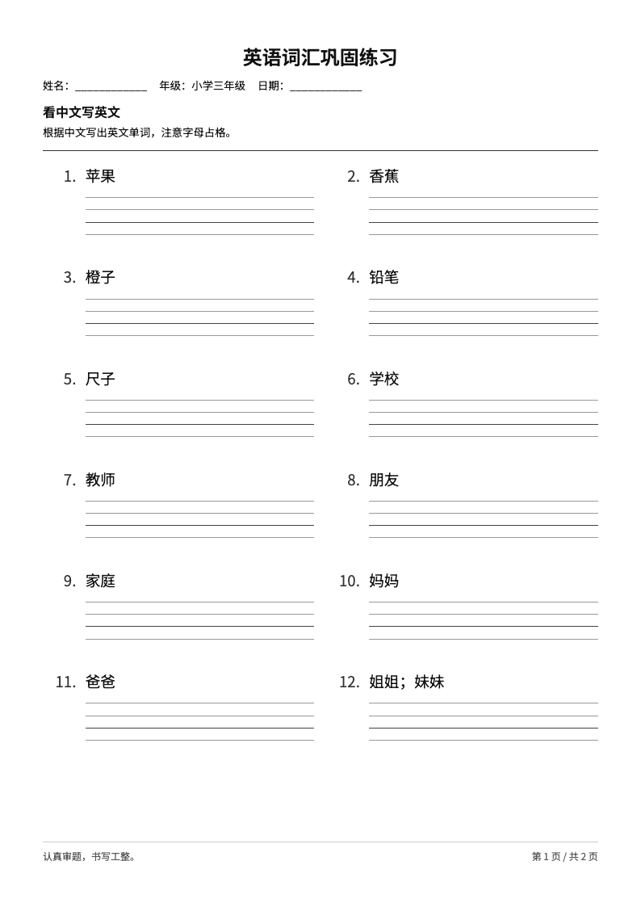
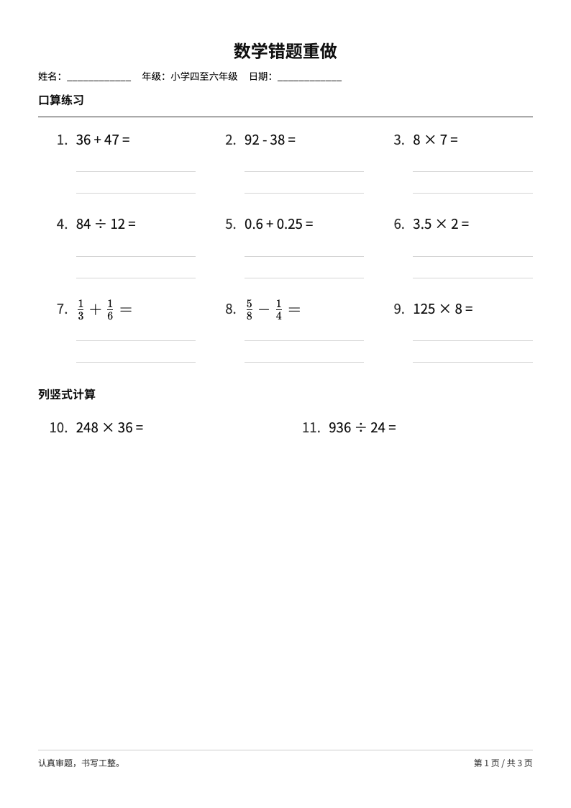
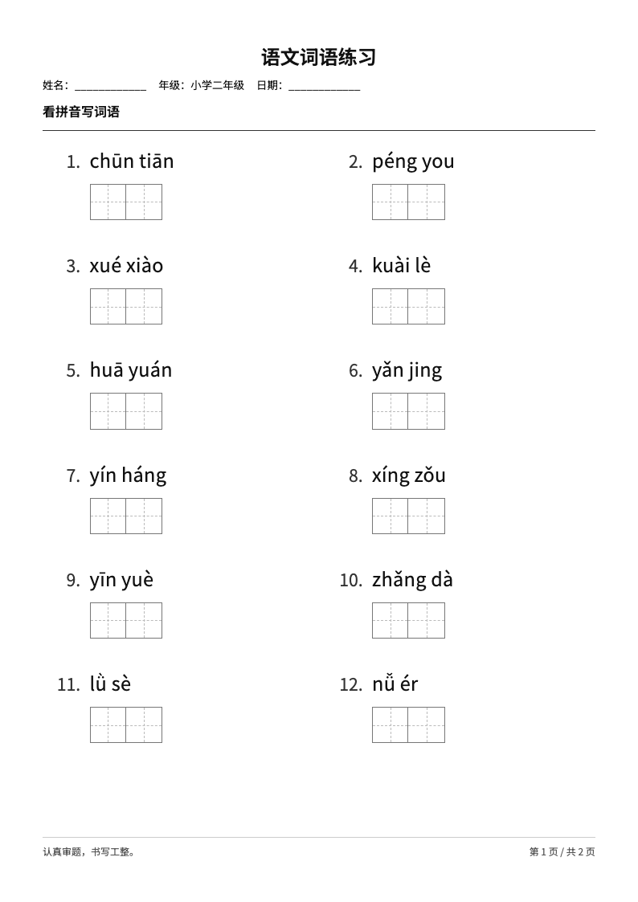

# 学习任务纸（study-sheet）

把词表、题目或错题整理成可打印的 A4 学习任务纸，留出手写空间，并可按需生成独立答案册。提供 Codex、Claude Code 和 WorkBuddy 的技能目录安装方式，实际验证范围见[宿主兼容性记录](docs/compatibility.md)。

[](https://github.com/cabbage2000-lab/study-sheet/actions/workflows/ci.yml)
[](LICENSE)

## 看看输出

| 英语默写 | 数学练习 | 语文练习 |
| --- | --- | --- |
| [](docs/examples/english.pdf) | [](docs/examples/math.pdf) | [](docs/examples/chinese.pdf) |

点击预览查看完整学生版 PDF。素材来自仓库中的公开示例词表与题目，不含学生资料。完整离线 HTML 和答案册可通过 `npm run samples` 生成；版本附件见 [Releases](https://github.com/cabbage2000-lab/study-sheet/releases)。

## 能做什么

| 学科 | 练习类型 |
| --- | --- |
| 英语 | 根据中文写英文、根据英文写中文，可使用四线格 |
| 数学 | 口算、列竖式、脱式计算、应用题和原题重做 |
| 语文 | 看拼音写词语、词语抄写 |

同科题型可以混排，切换学科时另起一页；内容放不下时自动分页，保留答题空间。学生版提供离线 HTML 和 PDF，答案册仅在要求时单独生成。

图片和 PDF 的读取、题目转录、拼音核对及内容判断由宿主智能体完成，生成脚本不提供 OCR 或自然语言解析。复杂几何图和必须依靠图示才能解答的题目目前无法直接渲染。

## 安装

需要 Node.js **22.6 或更高版本**及 npm；生成 PDF 还需要 Chrome 或 Playwright Chromium。先获取源码：

```bash
git clone https://github.com/cabbage2000-lab/study-sheet.git
cd study-sheet
npm ci
```

在仓库根目录选择对应宿主执行。以下为 macOS / Linux 命令；Windows 可使用 Git Bash，并参考[兼容性记录](docs/compatibility.md)。

**Codex：**

```bash
npm run install:skill -- --host codex
npm --prefix "$HOME/.agents/skills/study-sheet" ci
```

**Claude Code：**

```bash
npm run install:skill -- --host claude
npm --prefix "$HOME/.claude/skills/study-sheet" ci
```

**WorkBuddy：**

```bash
npm run install:skill -- --host workbuddy
npm --prefix "$HOME/.workbuddy/skills/study-sheet" ci
```

如没有可用 Chrome，在仓库根目录执行 `npx playwright install chromium`；Linux 可使用 `npx playwright install --with-deps chromium`。也可设置 `STUDY_SHEET_CHROME` 指向浏览器可执行文件。安装后新开宿主会话，检查 `study-sheet` 是否可用。

只在单个项目使用时，为安装命令添加 `--project /path/to/project`。安装器会使用对应的 `.agents/skills/`、`.claude/skills/` 或 `.codebuddy/skills/`，并输出安装路径；随后在该路径执行 `npm ci`。安装器不修改其他技能，不自动安装浏览器。

### 更新与卸载

在源码仓库执行 `git pull --ff-only` 和 `npm ci`，然后重新运行对应安装命令并添加 `--update`，最后在技能目录执行 `npm ci`。更新会替换整份技能目录，请将自己修改的技能和练习材料先备份到安装目录以外；复制失败会保留原安装。没有 `--update` 时拒绝覆盖。

卸载时删除对应的 `study-sheet` 技能目录并新开会话即可；只删除这一目录，不要清空宿主的整个 `skills/`。仓库和其他目录中的练习文件可继续保留。

## 使用

在新会话中提供词表、题目、可读取的图片或文档，并描述年级、练习形式及是否需要答案：

```text
用 study-sheet 把下面的词表做成小学三年级英语默写纸，
根据中文写英文，使用四线格，并单独生成答案册：
apple 苹果
banana 香蕉
school 学校
```

```text
把这份错题整理成数学重做练习，保留原题顺序和条件，去掉原来的作答，
留出列竖式和计算空间，不要答案。
```

```text
用这些词语制作看拼音写词语练习，适合小学二年级，生成答案册：
春天、学校、朋友
```

未指定英语默写方向时，中英对照词表默认显示中文、填写英文。题目模糊、条件缺失或读音无法确定时，智能体应指出需要确认的内容。打印时选择 A4、实际大小（100%），并关闭浏览器附加页眉页脚。

## 命令行生成

生成器接受结构化任务 JSON，不直接理解自然语言。格式见[任务 JSON 协议](references/worksheet-schema.md)，三科输入见 [tests/fixtures](tests/fixtures/)。在仓库根目录运行：

```bash
npm run generate -- --input tests/fixtures/english.json --out output/example --answers
```

不需要答案时去掉 `--answers`；只需 HTML 时添加 `--html-only`。每次使用新的输出目录：同名任务文件已存在时，生成器会拒绝覆盖。

完整输出包括 `worksheet.html`、`worksheet.pdf` 和 `report.json`；使用 `--answers` 时另有 `answers.html` 和 `answers.pdf`。`worksheet.json` 是内部工作数据，可能含答案和来源，不应当作学生材料分享。HTML-only 不生成 PDF，也不完成浏览器布局或 PDF 校验。

## 开发与验证

```bash
npm run typecheck     # 类型检查
npm test              # 单元、样张更新与安装测试
npm run test:browser  # 排版、答案隔离及 PDF 测试
npm run samples       # 验证成功后更新 output/samples/，仅保留一套
npm run examples      # 将已验证样张的 PDF 与预览更新到 docs/examples/
```

浏览器测试和 PDF 导出需要 Chrome 或 Playwright Chromium。修改脚本或模板后应运行类型检查、单元测试和浏览器测试；修改排版后还应检查实际 PDF。中断的样张更新如何恢复，见[发布指南](docs/releasing.md)。

技能入口见 [SKILL.md](SKILL.md)，学科规则与实现说明位于 [references](references/)，模板和打印样式位于 [assets](assets/)。

## 反馈与许可

问题与建议通过 [GitHub Issues](https://github.com/cabbage2000-lab/study-sheet/issues) 提交；请提供虚构题目的最小复现，不上传学生个人信息。开发约定见 [CONTRIBUTING.md](CONTRIBUTING.md)，版本变化见 [CHANGELOG.md](CHANGELOG.md)。

原创源码采用 [MIT License](LICENSE)。字体与第三方组件遵循各自许可，见 [THIRD_PARTY_NOTICES.md](THIRD_PARTY_NOTICES.md)。
